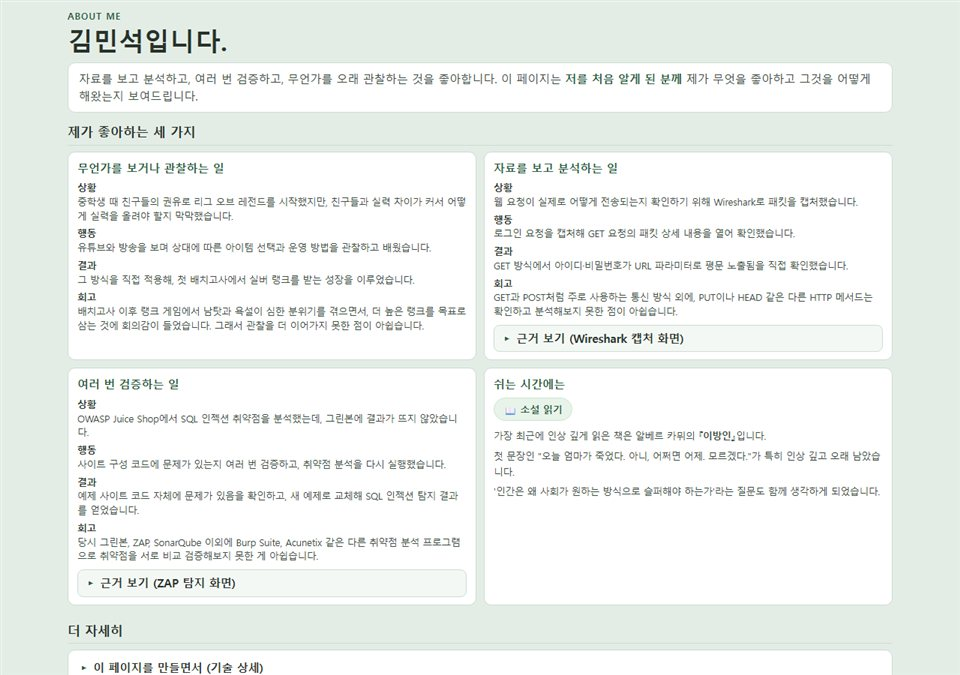
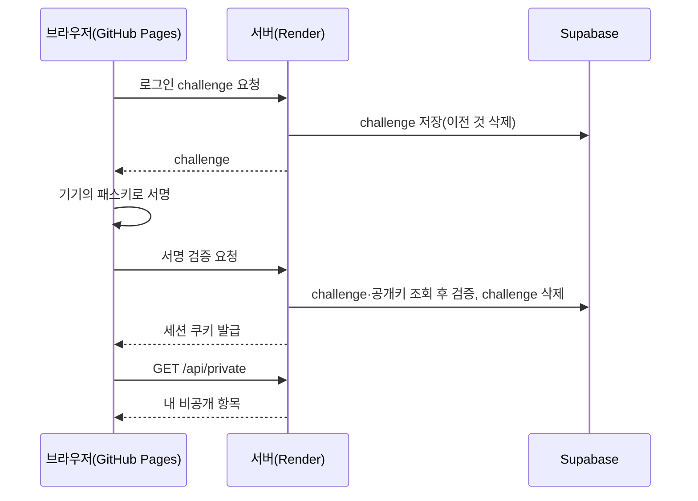

# one-page-intro

나를 처음 알게 된 사람에게 "무엇을 좋아하고, 그것을 어떻게 해왔는지"를 보여 주는 한 페이지 소개 사이트. 비밀번호 없이 패스키(WebAuthn)로만 들어가는 비공개 영역이 붙어 있습니다. (ALEPH 과정 과제 1 + 과제 8)

**[라이브 데모](https://ilb72.github.io/one-page-intro/)**



## 목차
[주요 기능](#주요-기능) · [기술 스택](#기술-스택) · [빠른 시작](#빠른-시작) · [패스키 흐름](#패스키-흐름) · [프로젝트 구조](#프로젝트-구조) · [설계 결정과 배운 점](#설계-결정과-배운-점) · [한계와 다음 할 일](#한계와-다음-할-일) · [연락](#연락)

## 주요 기능
**공개 영역 (과제 1)**
- 좋아하는 일 3개를 상황 · 행동 · 결과 · 회고 네 칸으로 설명하고, 분석 근거 캡처는 "근거 보기" 토글에 접어 두었습니다.
- 1366×768, 1920×1080 두 해상도에서 첫 화면을 확인했고, 콘솔·접근성 결함 3개(파비콘 404, `<main>` 태그 누락, 명암 대비)를 찾아 고쳐 Lighthouse 접근성 92점에서 100점이 되었습니다.

**비공개 영역 "나만의 공간" (과제 8)**
- 패스키로 등록·로그인, 로그아웃. 개인키는 기기(Google 비밀번호 관리자, 아이폰 Safari)에만 있고 서버에는 공개키만 저장합니다.
- 등록한 패스키 목록 조회·삭제. 마지막 한 개는 삭제할 수 없습니다.
- 계정마다 본인 비공개 항목만 반환합니다(계정 2개로 교차 확인).
- 비공개 항목은 서버 API로만 조회하고, 로그인 전에는 `401`을 돌려주고 HTML에는 내용이 들어 있지 않습니다.

## 기술 스택
- 프론트엔드: HTML · CSS · 순수 JavaScript, `@simplewebauthn/browser` (GitHub Pages)
- 백엔드: Node.js · Express · `@simplewebauthn/server` · express-session (Render)
- 데이터: Supabase(PostgreSQL) — 사용자, 패스키 공개키, challenge 저장

## 빠른 시작
**소개 페이지만 보기** (요구 사항: Python 3 또는 아무 정적 서버)

```bash
git clone https://github.com/ILB72/one-page-intro.git
cd one-page-intro
python -m http.server 8000     # http://localhost:8000
```

> [!NOTE]
> 로컬 페이지에서도 `index.html`의 `BACKEND_URL`은 배포된 백엔드를 가리킵니다. 패스키는 배포 주소(`ilb72.github.io`)에 묶여 있어 `localhost`에서는 로그인되지 않습니다. 패스키까지 확인하려면 라이브 데모를 쓰세요.

<details>
<summary>백엔드를 직접 띄우려면 (Node.js 18 이상, Supabase 프로젝트 필요)</summary>

```bash
cd backend
npm install
npm start      # 기본 포트 3000
```

`backend/.env`를 만들어 아래 변수를 채웁니다(값은 저장소에 올리지 않습니다).

| 변수 | 용도 |
|---|---|
| `SUPABASE_URL`, `SUPABASE_SECRET_KEY` | Supabase 접속 |
| `SESSION_SECRET` | 세션 서명용 비밀 문자열 |
| `RP_ID` | 패스키가 묶이는 도메인 (기본 `localhost`) |
| `ORIGIN` | 프론트엔드 주소 (기본 `http://localhost:3000`) |

Supabase에는 `users`, `credentials`, `challenges` 세 테이블이 필요합니다(코드가 사용하는 이름. 테이블 생성 SQL은 이 저장소에 없습니다).

</details>

## 패스키 흐름


## 프로젝트 구조
```
one-page-intro/
├── index.html          소개 페이지와 패스키 UI (GitHub Pages 루트)
├── images/             분석 근거 캡처 (Wireshark, ZAP)
├── docs/images/        README용 스크린샷
└── backend/
    ├── server.js       Express 설정(프록시 신뢰, CORS, 세션 쿠키)
    └── routes/
        ├── auth.js     패스키 등록·로그인·목록·삭제, 로그아웃
        └── private.js  비공개 항목 조회(로그인 필요)
```

## 설계 결정과 배운 점
- **React 대신 순수 HTML/CSS.** 빌드 단계와 콘솔 오류 위험을 줄이고 과제 기준(열림·접근성)에 집중하려는 AI 제안을 받아들였습니다. 반면 "수업 동기"로 대상을 더 좁히자는 제안은 "처음 알게 된 사람"이면 충분히 명확하다고 보고 받아들이지 않았습니다.
- **개인정보는 직접 가렸습니다.** Wireshark 캡처에 비밀번호가 보여서 가림 처리하고, 문장도 "GET 요청 평문 노출 확인"으로 바꿨습니다.
- **서버를 따로 둔 이유.** GitHub Pages는 정적 파일만 호스팅해서 Node 서버는 Render에 두고, Render 무료 플랜은 파일이 휘발되므로 공개키를 Supabase에 저장했습니다.
- **막혔던 오류와 해결.** CORS, challenge 불일치, `credential not found`가 연달아 나왔습니다. 프록시 신뢰(`trust proxy`)와 `sameSite: none` + `secure` 쿠키를 설정하고, challenge를 세션 대신 DB에 저장했으며, 패스키 id를 `Uint8Array`로 변환해 해결했습니다.
- **기기 분실 시나리오.** PC에 블루투스가 없어 아이폰 패스키를 PC에서 선택할 수 없었습니다. "PC에 패스키 2개를 등록하라"는 AI 제안은 분실 대비가 약해져 거부하고 PC 1 + 아이폰 1을 유지했습니다. 한 개를 삭제해도 남은 패스키로 로그인되고, 삭제한 패스키는 선택지에 뜨지 않음을 확인했습니다. 테스트용으로 풀었던 설정은 원래대로 되돌렸습니다.

## 한계와 다음 할 일
- 컴퓨터에서 아이폰에 저장한 패스키를 쓸 수 없는 점은 막지 못한 한계로 남겼습니다.
- 서버가 무료 플랜이라 한동안 접속이 없으면 첫 요청이 느릴 수 있습니다.
- 학습용 구현입니다. 공개 서비스로 쓰려면 별도의 보안 점검(등록·CORS·세션 설정 등)이 먼저 필요합니다.
- [ ] 테이블 생성 SQL을 저장소에 추가

<details>
<summary>과제 1 공개 범위 점검표 (제출 당시 기록)</summary>

**대상과 목적**: 나를 처음 알게 된 사람에게 내가 무엇을 좋아하고 그것을 어떻게 해왔는지 보여 주기 위한 페이지.

**공개한 것**: 이름 / 좋아하는 일 3개와 각각의 상황·행동·결과·회고(리그 오브 레전드 관찰, Wireshark 패킷 분석, Juice Shop 취약점 검증) / 취미(소설 읽기).

**공개하지 않기로 한 것**: 연락처(전화·이메일), 상세 주소, 생년월일·가족·개인사. 이 세 가지는 페이지, 배포 파일, Git 기록, 제출물 어디에도 넣지 않았습니다.

공개 주소: https://ilb72.github.io/one-page-intro/ · 소스: https://github.com/ILB72/one-page-intro

</details>

## 연락
문의나 제안은 이 저장소의 [Issues](https://github.com/ILB72/one-page-intro/issues)를 이용해 주세요. 이 소개 페이지 본문에는 연락처를 싣지 않았습니다.
